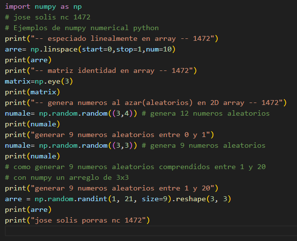
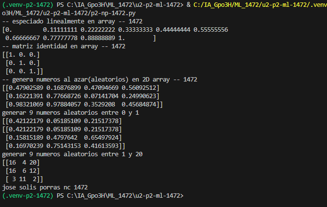

start=0: Valor inicial de la secuencia.

stop=1: Valor final de la secuencia.

num=5: Cantidad de valores que se generan entre el inicio y el final, incluyendo ambos extremos.

## que hace np.linspace
es una funcion que genera una secuencia de números espaciados uniformemente entre un valor inicial y uno final.

## el codigo

## el resultado

